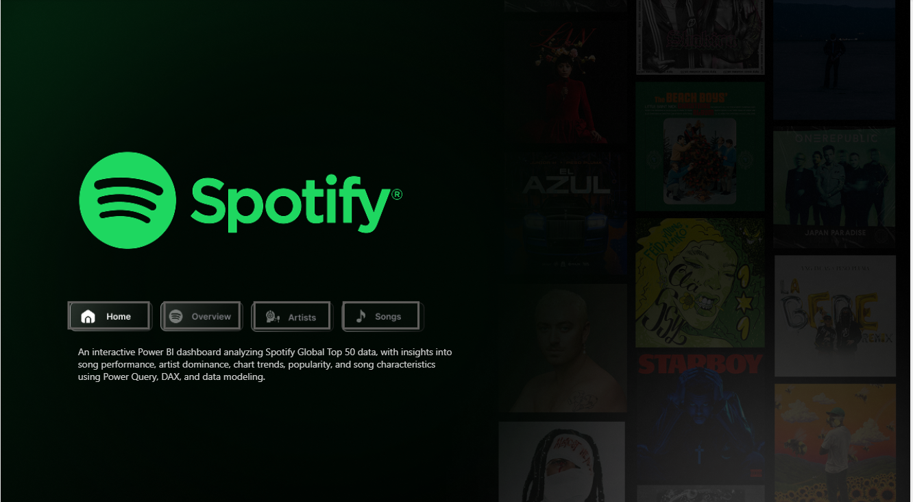
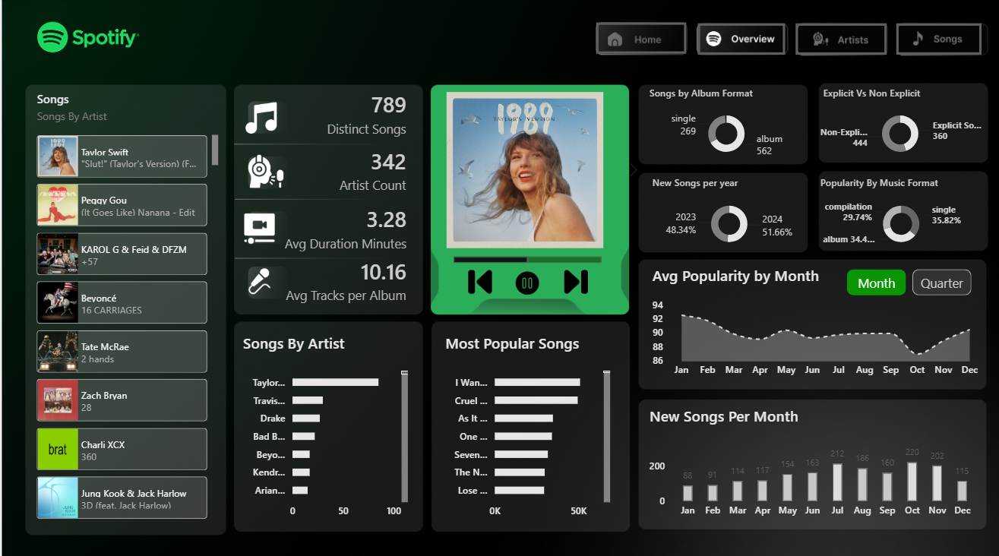
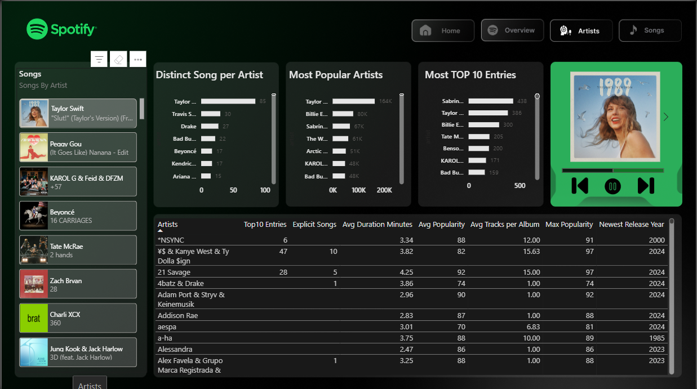
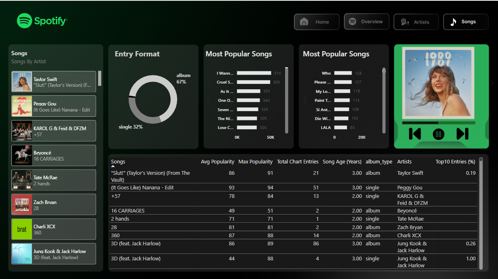

# 🎵 Spotify Global Top 50 — Power BI Dashboard

## 📸 Preview

**Home / Landing Page**



**Overview Page**


**Artists Page**



**Songs Page**



## 🎯 What It Answers

* Which songs and artists dominate the Global Top 50?
* How does popularity vary by chart position, month, and quarter?
* Do explicit songs perform differently from non-explicit ones?
* How long do songs stay on the chart, and how fast do new releases enter it?
* Album vs. single vs. compilation performance

## 🛠️ Built With

`Power BI Desktop` · `Power Query` · `DAX` · `DAX Studio`

## 🧹 Data Prep

* Cleaned and validated types (dates, duration, boolean explicit flag)
* Converted track duration from ms → minutes
* Built a dedicated Date table linked 1:\* to the fact table
* Structured a separate `\_Measure` table to keep DAX organized

## 🧮 Key DAX Measures

Chart performance (`#1 Entries`, `Top 10 Entries`, `Distinct Songs per Artist`), song characteristics (`% Explicit Entries`, `Avg Duration`), and time intelligence (`7-Day Moving Avg Popularity`, `Popularity Change vs. Previous Day`).

> \*\*Note:\*\* Chart \*entries\* ≠ unique \*songs\* — a song charting for 100 days = 100 entries but 1 unique song. This distinction drives the longevity and dominance metrics throughout the dashboard.

## 📈 Dashboard Pages

|Page|Focus|
|-|-|
|**Overview**|KPIs, top songs/artists, format \& popularity breakdowns|
|**Artists**|Chart presence, dominance, songs per artist *(in progress)*|
|**Songs**|Longevity, position trends, explicit vs. non-explicit performance *(in progress)*|

## 🗂️ Dataset

|Metric|Value|
|-|-:|
|Chart Entries|27,800|
|Distinct Songs|794|
|Distinct Artists|343|
|Period|May 2023 – Nov 2024|

## 📁 Repository Structure

```
Spotify-PowerBI-Dashboard/
├── README.md
├── Dataset/spotify-top-50-world.csv
├── PowerBI/Spotify\_Global\_Top50.pbix
└── Screenshots/
```

## 💡 Future Improvements

* Artist \& song drill-through pages
* Ranking movement analysis
* Audio features (danceability, energy, valence)

## 👨‍💻 Author

**Arijit Dutta** — Aspiring Data Analyst | Power BI · SQL · Excel · Python
[GitHub](https://github.com/arijitddutta)

⭐ If you find this useful, consider starring the repo!

